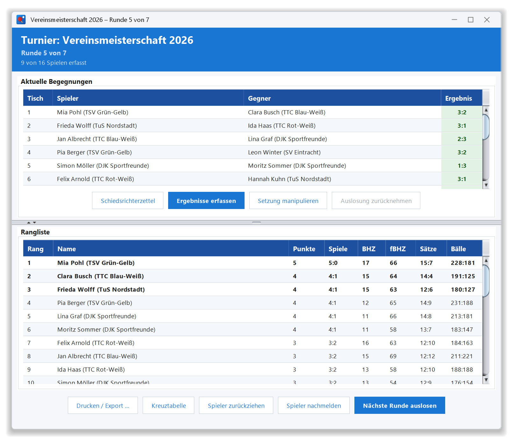

# 🏓 TableTennisTournamentSoftware

## Übersicht

**TableTennisTournamentSoftware** ist eine Java-basierte Desktop-Anwendung zur Verwaltung von Tischtennisturnieren.  
Sie unterstützt das **Schweizer System**, den Modus **„Jeder gegen Jeden“** sowie **Vorrunde in Gruppen mit anschließender KO-Runde**, jeweils als Einzel oder **Doppel**, und bietet eine benutzerfreundliche Oberfläche für Spielerverwaltung, Auslosung, Ergebniseingabe und Schiedsrichterzettel.

📸 **Screenshots und Vorstellung:** [docs/Vorstellung.md](docs/Vorstellung.md)



---

## ✨ Funktionen

- 💾 **Automatisches Speichern** gleich nach der ersten Auslosung, nach jeder Ergebniseingabe, Setzungsänderung und Runde sowie beim Schließen
- 🔁 **Fortsetzen unterbrochener Turniere** durch Laden gespeicherter `.ser`-Dateien
- 🏆 **Vorrunde in Gruppen + KO-Runde** mit Turnierbaum (Anzeige und Druck); Spiel um Platz 3 wahlweise
- 👫 **Doppelkonkurrenzen**: Teilnehmer sind Paare; Setzung nach der Summe beider TTR-Werte, jede Person nur in einem Doppel
- 👥 **Spielerverwaltung**: Hinzufügen, Bearbeiten (auch per Doppelklick), Entfernen mit Rückfrage; gleiche Vor- und Nachnamen werden abgelehnt
- 🎲 **Setzliste**: nach TTR; bei gleichem oder fehlendem TTR entscheidet das Los
- 📋 **Turnierablauf**: Auslosung mit Rückfrage, „Auslosung zurücknehmen“ solange noch kein Ergebnis erfasst ist, optionale Rundenzahl im Schweizer System
- 🚪 **Spieler zurückziehen** (alle Turnierformen) und **Spieler nachmelden** (Schweizer System, nicht mehr in der letzten geplanten Runde)
- 🪑 **Automatische Tischzuweisung** für jede Begegnung
- 🧮 **Ergebniseingabe**: satzweise mit Prüfung der Tischtennisregeln, Statusanzeige pro Spiel, Tastaturbedienung (Enter, Strg+S, Esc), „Kampflos“-Schaltflächen, Korrektur früherer Runden (ein KO-Ergebnis kann den Sieger nicht mehr ändern, sobald die nächste KO-Runde ausgelost ist)
- 🖨️ **Drucken**: Rangliste bzw. Gruppentabellen (nach Turnierende mit Endplatzierung), Kreuztabelle (kompakt) und Schiedsrichterzettel (6 pro Seite, mit Turniername und Runde bzw. Gruppe oder KO-Runde; lange Namen und Doppel zweizeilig)
- 🛠️ **Manuelle Anpassung der Setzung** (nur im Schweizer System)
- ⚠️ **Fehlerdialog** bei unerwarteten Fehlern, Details in `Turniersoftware-Fehler.log`

---

## 🔀 Auslosung im Schweizer System

Die Runde wird als Ganzes optimiert (gewichtetes Matching nach Edmonds), ohne Wiederholungsbegegnungen. Kriterien in dieser Reihenfolge:

1. Möglichst wenige und kleine Punktsprünge zwischen den Punktgruppen
2. Niemand soll wie in der Vorrunde erneut herunterrutschen bzw. hochgeholt werden (ein Freilos zählt als Herunterrutschen)
3. Dasselbe für die Runde davor (schwächer gewichtet)
4. Herunter rutscht der Letzte der höheren Gruppe, er trifft auf den Bestplatzierten der niedrigeren
5. Innerhalb einer Punktgruppe: obere gegen untere Hälfte (1–5, 2–6, …)

Bei ungerader Spielerzahl erhält der niedrigstplatzierte Spieler ohne bisheriges Freilos das Freilos. Ist keine Runde ohne Wiederholung mehr möglich oder die geplante Rundenzahl erreicht, ist das Turnier beendet.

---

## 🏆 Vorrunde in Gruppen + KO-Runde

- **Einstellungen:** Gruppengröße (feste Höchstgröße; geht es nicht auf, haben einige Gruppen einen Teilnehmer weniger), Anzahl Weiterkommende je Gruppe, zusätzlich die x besten Nächstplatzierten (z. B. die besten Gruppendritten), Spiel um Platz 3 ja/nein
- **Gruppeneinteilung:** nach Setzliste im Schlangensystem (A1, B1, C1, C2, B2, A2, …)
- **Vorrunde:** Jeder gegen Jeden in jeder Gruppe, alle Gruppen spielen parallel; Platzierung mit direktem Vergleich nach ITTF
- **Gruppentabellen:** statt einer Rangliste eine Tabelle je Gruppe wie auf dem Papierbogen: Nr., Name, Ergebnis gegen jeden Gruppengegner, Spiele, Sätze, Bälle, Punkte, Platz; Weiterkommende sind grün markiert (während der Vorrunde vorläufig); „Tabelle drucken“ druckt die Gruppentabellen
- **Beste Nächstplatzierte:** Vergleich über die Gruppen nach Punkten pro Spiel, dann Satz- und Balldifferenz pro Spiel, dann TTR
- **Turnierbaum:** Gruppensieger vor Gruppenzweiten vor den übrigen Weiterkommenden, jeweils nach TTR; Freilose immer für die Bestgesetzten; Teilnehmer derselben Gruppe treffen möglichst spät aufeinander
- **KO-Runde:** Best of 5; mit Spiel um Platz 3 Endplatzierung 1–4, ohne teilen sich beide Halbfinal-Verlierer Platz 3; danach geteilte Plätze 5, 9, …
- **Rückzug:** in der Vorrunde werden alle Gruppenspiele gestrichen (die Gegner sind in den restlichen Runden spielfrei); in der KO-Runde bleiben die Gruppenergebnisse bestehen und der Gegner kommt kampflos weiter (auch im Finale und im Spiel um Platz 3). Eine Runde, in der nach einem Rückzug nur noch Freilose übrig sind, wird trotzdem angelegt; das Turnier läuft danach normal weiter. Wer in der KO-Runde zurückzieht, verliert sein nächstes Spiel kampflos und erhält die Platzierung dieser Runde (z. B. Zweiter bei Rückzug vor dem Finale, Vierter bei Rückzug vor dem Spiel um Platz 3), egal ob das Spiel schon ausgelost war. Bleibt nach Rückzügen nur ein Qualifizierter übrig, gewinnt er das Finale kampflos. Ein Rückzug in der KO-Phase bleibt als solcher gespeichert, auch wenn die KO-Auslosung danach zurückgenommen wird

---

## 📊 Ranglistenberechnung

Gewertet werden nur entschiedene Spiele: Ein Spieler hat 3 Sätze gewonnen, alle Sätze sind gültig (mindestens 11 Punkte, 2 Punkte Vorsprung) und lückenlos erfasst.

**Schweizer System:** Punkte, Buchholz, Fein-Buchholz, Satzdifferenz, Balldifferenz.

- Freilos: 1 Punkt, aber kein Sieg und keine Sätze oder Bälle
- Ungespielte Runden in Buchholz und Fein-Buchholz nach der Richtung der FIDE-Überarbeitung 2026 (C.07):
  - Freilos und Runden ohne Paarung (Nachmeldung, Rückzug): virtueller Gegner mit den eigenen Punkten, höchstens aber der halben Rundenzahl („Mr. 50 %“; während des Turniers die halbe Zahl der bisherigen Runden), dazu für die Fein-Buchholz die eigene Buchholz
  - Kampflos (3 Sätze 11:0, wie von der Schaltfläche eingetragen): zählt für Punkte, Sätze und Bälle normal, für die Buchholz aber als ungespielt; beide Spieler werten einen virtuellen Gegner mit der niedrigeren Punktzahl (bzw. Buchholz) der beiden
  - Buchholzwerte können dadurch halbe Punkte enthalten (z. B. 12,5)

**Jeder gegen Jeden:** Punkte; bei Punktgleichheit der direkte Vergleich nach ITTF (Siege, dann Sätze, dann Bälle nur aus den Spielen der Punktgleichen untereinander; bleibt eine Teilgruppe gleich, wird für sie neu verglichen), danach Satz- und Balldifferenz aller Spiele. Spielfrei gibt 0 Punkte. Zieht sich ein Spieler zurück, werden alle seine Spiele gestrichen (auch bereits gespielte); er steht ohne Rang am Ende der Tabelle. Im Schweizer System bleiben die Ergebnisse eines zurückgezogenen Spielers bestehen.

Spieler, die in allen Kriterien gleich sind, teilen sich den Rang (z. B. 1, 2, 2, 4).

---

## 📂 Dateiverwaltung

- Gespeichert wird im **Dokumente-Ordner** des Benutzers (auch bei Umleitung, z. B. OneDrive), sonst im Benutzerverzeichnis
- `<Turniername>.ser` enthält immer den aktuellen Stand
- `<Turniername>_Runde_N.ser` ist eine Sicherung des Stands nach abgeschlossener Runde N
- Über den Menüpunkt **„Turnier laden“** kann eine gespeicherte Datei geöffnet und fortgesetzt werden
- Ein geladenes Turnier wird in `<Turniername>.ser` im Speicherordner fortgeschrieben. Wird eine andere Datei geladen (z. B. eine Rundensicherung) und gibt es diesen Stand schon, fragt das Programm vorher nach
- Ein neues Turnier mit dem Namen eines schon gespeicherten Turniers beginnt erst nach Rückfrage

---

## ⚠ Einschränkungen

- 🧪 Die Auslosung orientiert sich am holländischen System der FIDE, ist aber **nicht offiziell TTR-konform**
- Satz- und Balldifferenz werden als Differenz gerechnet, nicht als Verhältnis

---

## 💻 Installation für Anwender

Unter **Releases** auf GitHub gibt es fertige Pakete mit eingebauter Java-Laufzeit, es muss kein Java installiert sein:

| System | Datei | Installation |
|---|---|---|
| Windows | `…-windows.msi` | Doppelklick, Installer folgen; danach im Startmenü „TT-Turniersoftware“ |
| Windows (ohne Installation) | `…-windows-portable.zip` | entpacken, `TT-Turniersoftware.exe` starten |
| macOS | `…-macos-arm64.dmg` (Apple Silicon) / `…-macos-x64.dmg` (Intel) | öffnen, App in „Programme“ ziehen |
| Linux | `.deb` / `.rpm` / `…-linux-x64.tar.gz` | über die Paketverwaltung installieren bzw. entpacken und `bin/TT-Turniersoftware` starten |

Die Pakete sind **nicht signiert**. Beim ersten Start erscheint deshalb eine Warnung:
- **Windows:** „Der Computer wurde durch Windows geschützt“ → „Weitere Informationen“ → „Trotzdem ausführen“
- **macOS:** App mit Rechtsklick → „Öffnen“ starten und bestätigen

---

## 📦 Pakete bauen (für Entwickler)

```bash
# Paket für das aktuelle System (Ordner unter build/dist)
./gradlew jpackage

# Installer: msi (Windows, benötigt das WiX Toolset), deb/rpm (Linux), dmg (macOS)
./gradlew jpackage -PinstallerType=msi
```

Ein Release für alle Systeme entsteht automatisch über GitHub Actions (`.github/workflows/release.yml`), sobald ein Versions-Tag gepusht wird:

```bash
git tag v1.0.0
git push github v1.0.0
```

Das Programmsymbol wird mit `java packaging/IconGenerator.java` erzeugt.

---

## ⚙️ Systemanforderungen & Ausführung

- **Java-Version**: Java 25 (nur zum Entwickeln; die Pakete bringen ihre eigene Java-Laufzeit mit)
- **Empfohlene Ausführung**:
    - Direkt in einer IDE wie IntelliJ IDEA oder Eclipse
    - Oder über Gradle:

```bash
# Anwendung starten
./gradlew run

# Tests ausführen
./gradlew test

# Ausführbare JAR erstellen
./gradlew build
```

---

## 🧩 Projektstruktur (für Entwickler)

- `controller` – Turnierlogik, UI-Aktionen, Speichern/Laden; u. a. `PairingEngine` (Auslosung), `WeightedMatching` (Matching-Algorithmus), `ScoreCalculator` (Wertung), `Standings` (Rangliste), `TournamentStorage` (Dateien)
- `model` – Datenklassen: `Player`, `Match`, `TournamentState`, `ResultRules` (Tischtennisregeln)
- `simulation` – `TournamentSimulation`: GUI-freie Simulation zum Testen der Auslosungslogik
- `view` – Swing-basierte Benutzeroberfläche (Erfassung, Tabellen, Menü, Zettel etc.)
- Einstiegspunkt: `TournamentController.main()`  
  Lädt das Hauptfenster und koordiniert den Ablauf

---

## 📜 Lizenz

[**Creative Commons Attribution-NonCommercial-ShareAlike 4.0 International (CC BY-NC-SA 4.0)**](https://creativecommons.org/licenses/by-nc-sa/4.0/deed.de)

> **Die Software ist ausschließlich für nicht-kommerzielle, nicht-TTR-relevante Turniere gedacht.**  
> Eine Nutzung in offiziellen oder leistungsrelevanten Wettkämpfen ist untersagt.

---

## 👨‍💻 Autor

**Mathias Weklak**
