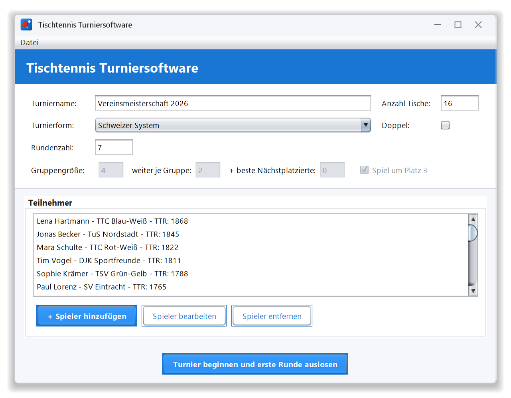
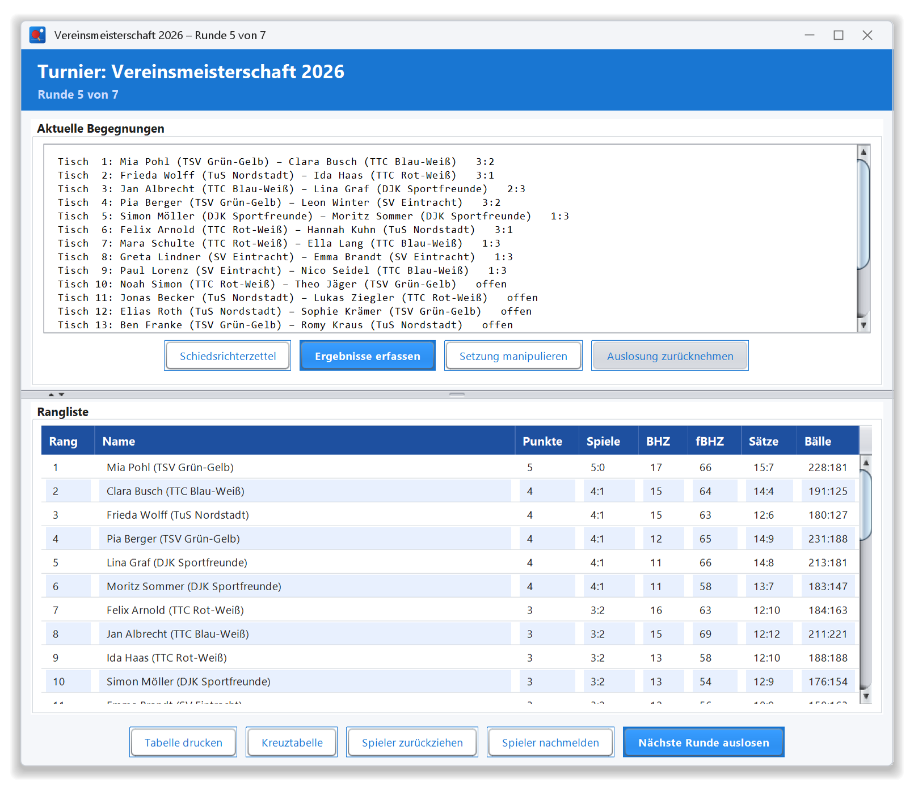
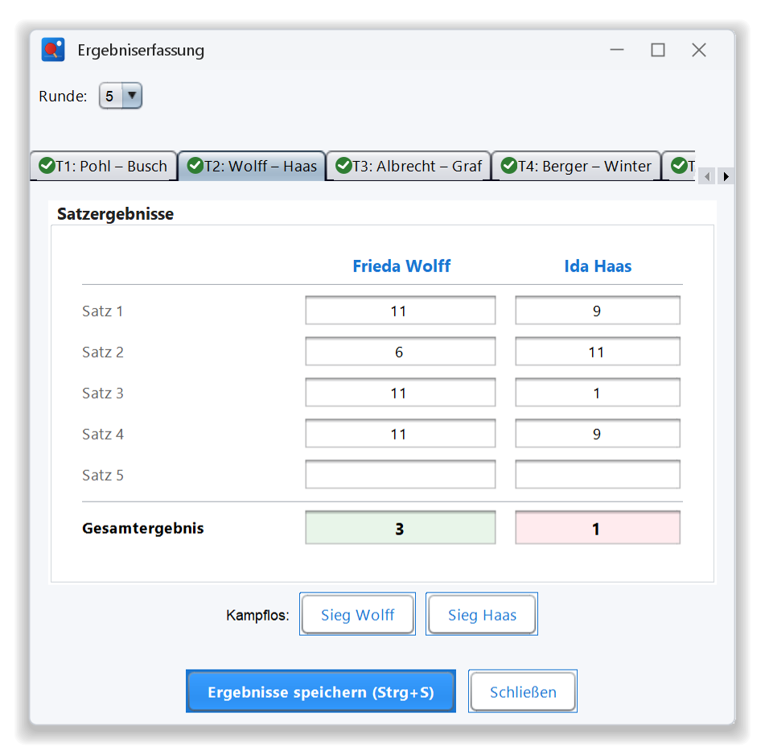
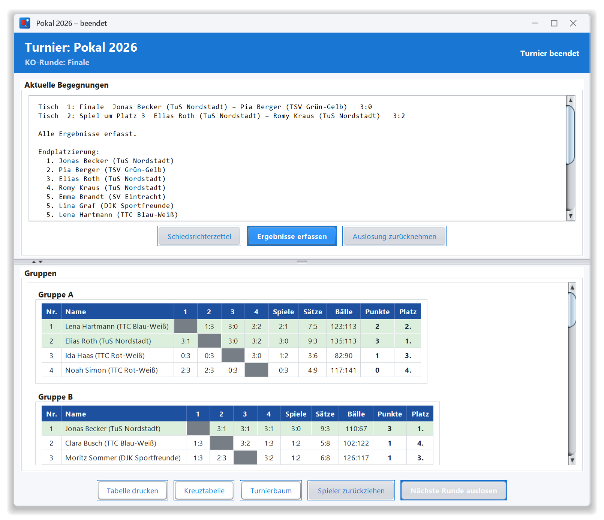
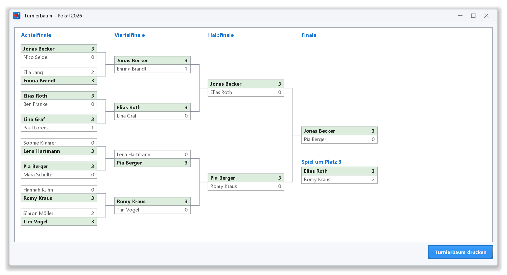
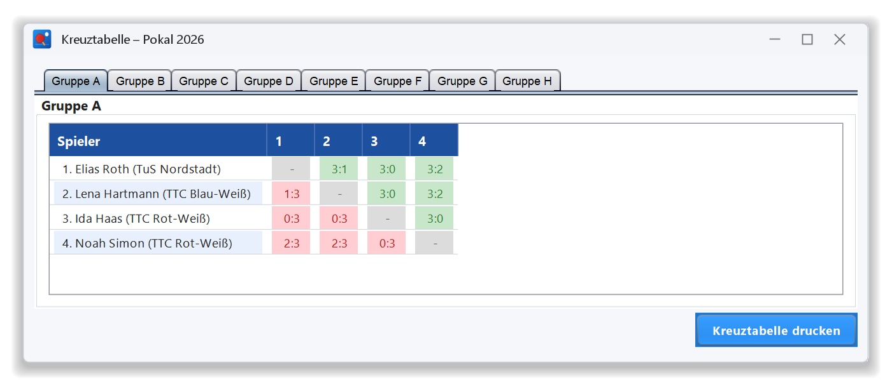
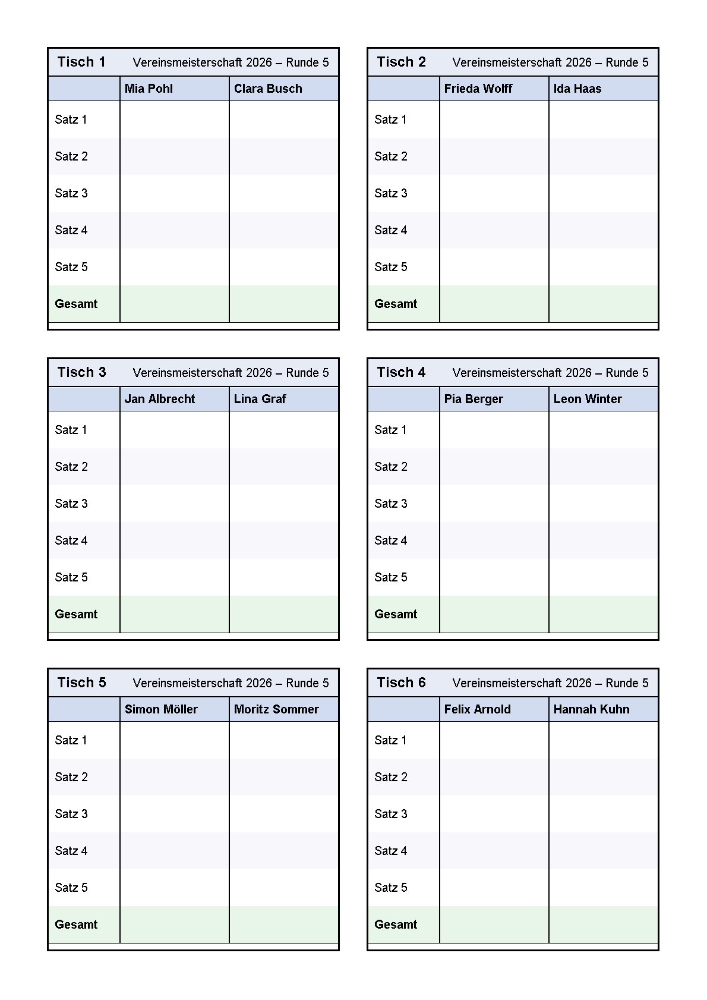
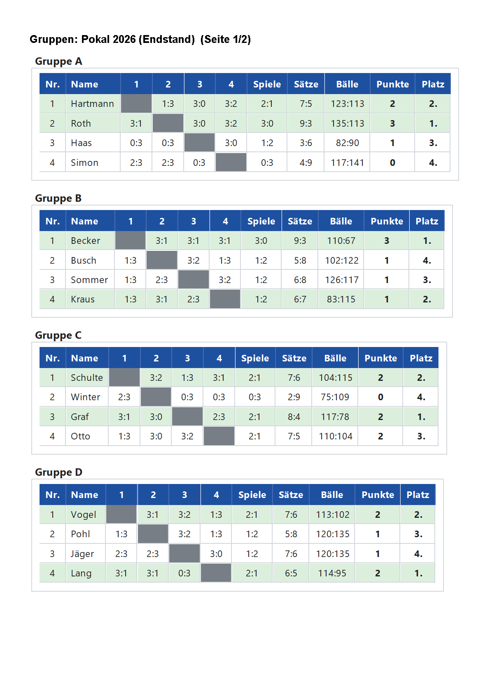
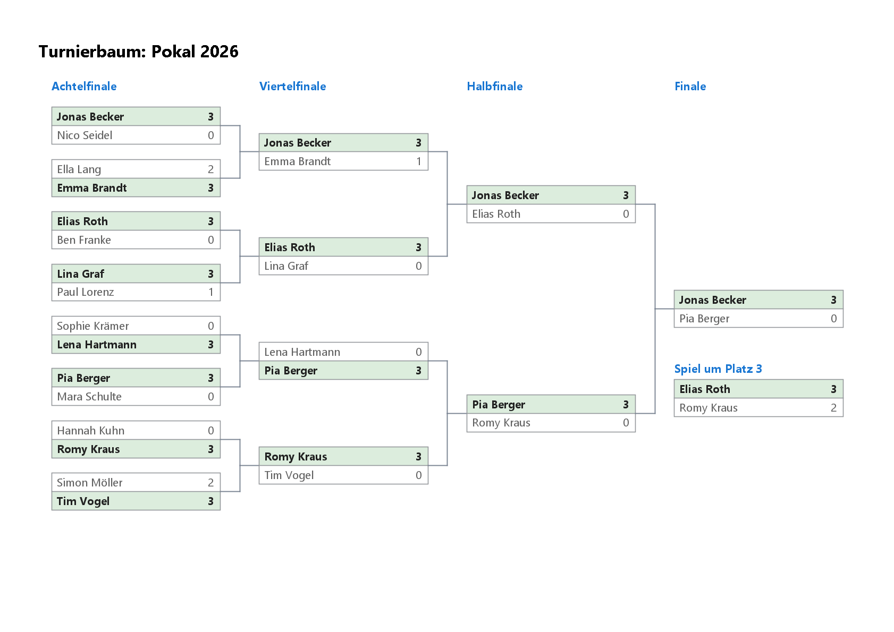
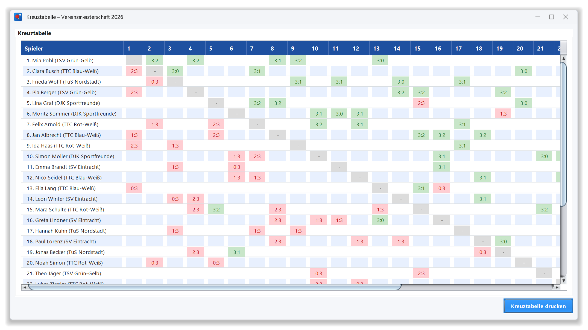

# 🏓 TT-Turniersoftware – Vereinsturniere ohne Zettelchaos

**Auslosen, Ergebnisse erfassen, Tabelle drucken – in Minuten statt Stunden.**
Die TT-Turniersoftware nimmt Turnierleitern die Rechenarbeit ab: vom Schweizer System über „Jeder gegen Jeden“ bis zum Pokal mit Gruppenphase und KO-Runde, im Einzel wie im Doppel. Kostenlos, ohne Anmeldung, auf Windows, macOS und Linux.

---

## In fünf Minuten startklar

Turniername, Anzahl der Tische und Turnierform wählen, Spieler eintragen – fertig. Die Setzliste entsteht automatisch nach TTR, bei Gleichstand entscheidet das Los.

---

## Faire Auslosung im Schweizer System

Die Software lost jede Runde als Ganzes aus, nicht Paarung für Paarung. So spielen möglichst alle gegen Gegner mit gleicher Punktzahl, niemand trifft zweimal auf denselben Gegner und das Freilos geht nie zweimal an dieselbe Person. Die Rangliste mit Buchholz und Feinbuchholz ist nach jeder Eingabe aktuell.

---

## Ergebnisse schnell und fehlerfrei erfassen

Satz für Satz eintippen, Enter springt weiter. Die Software kennt die Tischtennisregeln: ein 11:10 oder ein fehlender Satz fällt sofort auf, ein grüner Haken zeigt fertige Spiele. Für Nichtantritt gibt es eine Schaltfläche „Kampflos“.

---

## Pokal mit Gruppenphase und KO-Runde

Gruppengröße, Anzahl der Weiterkommenden und „die besten Gruppendritten“ sind frei einstellbar, das Spiel um Platz 3 ebenso. Die Gruppen werden nach Setzliste verteilt und wie auf dem gewohnten Gruppenbogen angezeigt: jedes Ergebnis auf einen Blick, wer weiterkommt, ist grün markiert. Im Turnierbaum treffen Spieler derselben Gruppe so spät wie möglich aufeinander. Am Ende steht die komplette Platzierung fest.

---

## Einzel und Doppel

Doppel werden einfach als Paar eingetragen. Gesetzt wird nach der Summe beider TTR-Werte, und kein Spieler kann versehentlich in zwei Doppeln landen.

---

## Alles auf Papier, wenn es drauf ankommt

Schiedsrichterzettel (sechs pro Seite, mit Turnier und Runde), Rangliste, Gruppentabellen, Kreuztabelle und Turnierbaum lassen sich direkt drucken – für die Wand in der Halle oder die Mappe der Turnierleitung.

| Schiedsrichterzettel | Gruppentabellen | Turnierbaum |
|---|---|---|
|  |  |  |

---

## Durchdacht bis ins Detail

- **Nichts geht verloren:** Jede Eingabe wird sofort gespeichert, ein abgebrochenes Turnier lässt sich jederzeit weiterführen.
- **Korrekturen möglich:** Ergebnisse früherer Runden nachträglich ändern, eine Auslosung zurücknehmen, Spieler zurückziehen oder nachmelden.
- **Regelgerecht:** Freilos, kampflose Spiele und Buchholz nach FIDE-Vorbild (Stand 2026), direkter Vergleich bei Punktgleichheit nach ITTF.
- **Für jeden Rechner:** Installationspakete für Windows, macOS und Linux mit eingebauter Java-Laufzeit – einfach herunterladen und starten.

---

## Jetzt ausprobieren

👉 **Download:** unter [Releases](https://github.com/mathiasWeklak/TableTennisTournamentSoftware/releases) die Datei für dein System wählen.

Die TT-Turniersoftware ist für nicht-kommerzielle Vereins-, Hobby- und Freizeitturniere gedacht (Lizenz CC BY-NC-SA 4.0); für TTR-relevante Turniere ist sie nicht vorgesehen.
